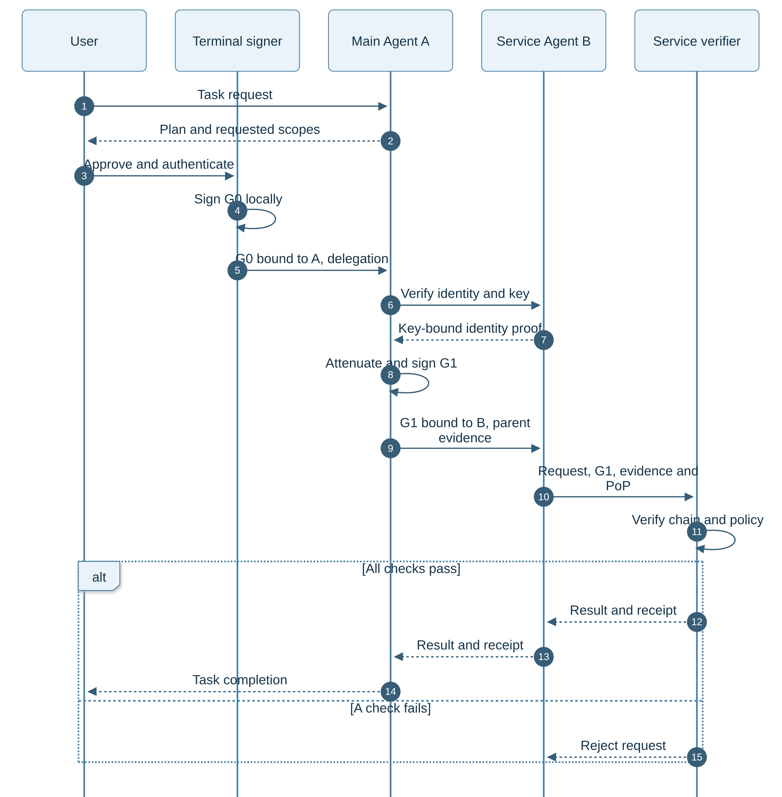

.. raw:: latex

   \appendix
   \setcounter{chapter}{1}
   \setcounter{secnumdepth}{-1}
   \setcounter{figure}{0}

.. raw:: latex

   \clearpage

Annex A - Illustrative two-level delegation scenario
====================================================

This annex illustrates the requirements in Chapter 2 using a user-authorized task. A personal AI
assistant is one possible deployment. The flow shows a user, coordinating agent A, service agent B
and verifier; terminal signing and interactive approval are choices for this example, not
requirements of the general model. It is not a separate implementation specification.

A.1 Actors and trust boundaries
-------------------------------

+-------------------------------------------------+-------------------------------------------------+
| Actor                                           | Responsibility                                  |
+=================================================+=================================================+
| User U                                          | Reviews the proposed plan and permissions;      |
|                                                 | authorizes permitted delegation.                |
+-------------------------------------------------+-------------------------------------------------+
| Terminal signing component                      | Presents the exact grant for approval,          |
|                                                 | authenticates the user locally, and uses the    |
|                                                 | user's signing key inside the terminal.         |
+-------------------------------------------------+-------------------------------------------------+
| Main agent A (coordinator)                      | Interprets intent, proposes subtasks, selects   |
|                                                 | eligible agents and creates attenuated child    |
|                                                 | grants.                                         |
+-------------------------------------------------+-------------------------------------------------+
| Service agent B                                 | Performs its assigned subtask using its own     |
|                                                 | identity, private key and child grant. Other    |
|                                                 | providers may supply sibling agents.            |
+-------------------------------------------------+-------------------------------------------------+
| Service verifier S                              | Enforces authorization at the service or        |
|                                                 | resource boundary before executing an           |
|                                                 | operation. It may be part of B's provider, but  |
|                                                 | is a distinct logical enforcement role.         |
+-------------------------------------------------+-------------------------------------------------+

The terminal signing component is a local function, not an additional delegating principal. User
authentication unlocks or authorizes signing; biometric templates, passwords and private keys are
not sent to agents. Each verifier needs a trusted basis for the user's and agents' identity-to-key
bindings. A valid user signature alone does not establish that the user owns every resource named in
the grant.

A.2 Two-level sequence
----------------------

**Step 1 - Plan.** A interprets the user's request and returns a structured task plan with requested
permissions. Discovered capabilities influence routing but do not enlarge authority.

**Step 2 - Approve and sign.** The terminal displays understandable task, data, recipient-policy,
spending, duration and delegation terms. After explicit approval and local user authentication, it
signs G0. The signature covers the canonical authorization content and a binding to the approved
plan or its relevant task commitments.

**Step 3 - Delegate.** A first verifies G0, its binding to A's key and its explicit delegation
authority. A then verifies B's identity and key, checks that B meets the approved recipient policy,
selects the necessary task branch and creates G1. G1 refers cryptographically to G0, binds B's key,
narrows scope and lifetime, and prohibits further delegation in this example. A uses its own key or
an approved derivation mechanism. It does not alter and forward G0 as though the user signed the
child.

**Step 4 - Present and enforce.** B presents G1, minimal parent evidence and a fresh PoP bound to
the intended verifier and operation. S validates the chain, the user's underlying authority,
attenuation, status and the exact request. S then applies its own access policy before executing the
authorized operation.

**Step 5 - Return evidence.** S returns a service result and a verifiable receipt where required. B
reports the result to A, which provides the user with a task summary. Receipts reference relevant
grants and operations without distributing unrelated authorization contents.

If the plan requires more authority, a new recipient category or a wider budget, A returns to the
user for a revised authorization. A failed verification causes rejection rather than fallback to a
broad credential.

   Illustrative two-level delegation: user to main agent, then main agent to service agent.
   Mermaid source is included in the source package.
